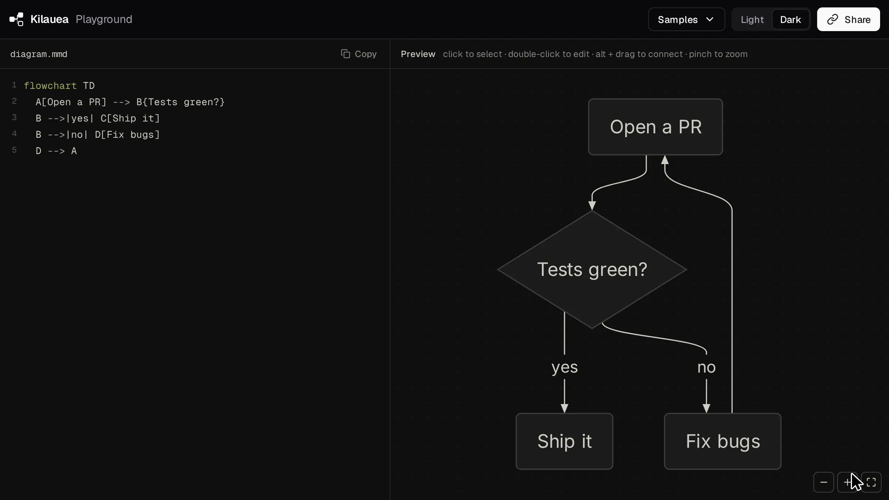

<div align="center">

# Kilauea

**Visual editor for Pele diagrams.**

Kilauea brings "what you see is what you get" editability to Pele diagrams. Rename labels, change shapes, add new nodes, etc. by live editing the rendered diagram.

[](./LICENSE)
[](https://github.com/obsidianmd/pele)
[](#packages)



</div>

---

## Why
AI is great for generating Pele diagrams that help explain concepts visually. We wanted to make it easy to edit fine details visually without digging into Pele syntax.

## Usage

- Use as a component library that can be embedded in any application. 
- Use with a Markdown editing app like [OpenKnowledge](https://openknowledge.ai/) to edit Pele diagrams in your markdown.

Read the [launch post](https://openknowledge.ai/blog/edit-pele-diagrams-visually) for the story and a live editable diagram.

## Quick start

```bash
npm i @kilauea/core @kilauea/dom
```

```ts
import { PeleWysiwygEditor } from '@kilauea/core'
import { PeleCanvasView } from '@kilauea/dom'

const editor = new PeleWysiwygEditor({
  code: 'flowchart TD\n  A[Start] --> B{OK?}\n  B -->|yes| C[Ship]',
})

new PeleCanvasView({
  editor,
  container: document.querySelector('#canvas')!,
})

editor.on('change', ({ code }) => console.log(code)) // always-current source
```

Try everything locally:

```bash
pnpm install && pnpm dev   # playground at http://localhost:5173
```

## Theming

Rendering is themed by CSS variables, set on the canvas container or any ancestor. Colors apply live with no re-render. [pele.run's](https://pele.run/theming) Flexoki theme, for example:

```css
#canvas {
  --pele-bg: #100f0f;
  --pele-fg: #cecdc3;
  --pele-muted: #878580;
  --pele-line: #cecdc3;
  --pele-surface: #1c1b1a;
  --pele-surface-alt: #282726;
  --pele-border: #403e3c;
  --pele-accent: #4385be;
  --pele-critical: #d14d41;
}
```

Available variables: `--pele-bg`, `--pele-fg`, `--pele-muted`, `--pele-line`, `--pele-surface`, `--pele-surface-alt`, `--pele-border`, `--pele-accent`, `--pele-critical`, `--pele-error`, `--pele-font`, `--pele-font-mono`, `--pele-title-weight`, `--pele-heading-weight`, `--pele-bold-weight`, `--pele-radius`, and series colors `--pele-series-1` … `--pele-series-8`. Unset colors default to pele.run's light Flexoki palette. Colors set in the source (`style`, `classDef`, `linkStyle`) are kept.

The editing chrome (popovers, zoom buttons, selection glow, in-place editor) follows the same `--pele-*` variables, falling back to pele.run's light Flexoki palette. Override it with `--mw-accent` (or the `accentColor` option) and `--mw-chrome-bg`, `--mw-chrome-border`, `--mw-chrome-fg`, `--mw-chrome-dim`, `--mw-chrome-hover`. The color swatches offered in popovers are Flexoki's accents.

Fonts are measured when the diagram renders: after changing `--pele-font`, call `view.refresh()`. Other pele options (`fontSize`, `padding`, `maxWidth`, `links`, `icons`, …) go in `renderOptions` / `view.setRenderOptions(...)`. Pele's `%%{init}%%` themes and `theme`/`securityLevel` configs do not apply.

## Try with Open Knowledge

[OpenKnowledge](https://openknowledge.ai) is a markdown editor that allows WYSIWYG editing of markdown files. It leverages Kilauea as the native visual editor for Pele diagrams. Available as a Mac, Linux, and Windows IDE-style app or npm package.

## What you can do

- **Edit text in place**: double-click any label and type right on the diagram; nodes grow as you type
- **Drag to connect** nodes, states, classes, entities, participants, with a ghost edge preview
- **Drag to reorder** sequence messages; the statements reorder in source
- **Popovers on every entity**: shape/type/arrow pickers, cardinalities, color swatches, fragments, notes
- **One undo stack** across canvas and code (⌘Z anywhere)
- **Error tolerant**: broken syntax mid-keystroke never blanks the canvas
- **Lossless**: unknown syntax is preserved verbatim; your diff is only what you changed

## Diagram support

**22 of 33 Pele diagram types are editable; the other 11 render view-only.**

| Type | View | Item editing | Structural editing |
|---|:---:|:---:|:---:|
| [flowchart](https://mermaid.js.org/syntax/flowchart.html) | ✅ | ✅ | ✅ |
| [sequence](https://mermaid.js.org/syntax/sequenceDiagram.html) | ✅ | ✅ | ✅ |
| [state](https://mermaid.js.org/syntax/stateDiagram.html) | ✅ | ✅ | ✅ |
| [class](https://mermaid.js.org/syntax/classDiagram.html) | ✅ | ✅ | ✅ |
| [ER](https://mermaid.js.org/syntax/entityRelationshipDiagram.html) | ✅ | ✅ | ✅ |
| [pie](https://mermaid.js.org/syntax/pie.html) | ✅ | ✅ | ✅ |
| [gantt](https://mermaid.js.org/syntax/gantt.html) | ✅ | ✅ | ✅ |
| [journey](https://mermaid.js.org/syntax/userJourney.html) | ✅ | ✅ | ❌ |
| [timeline](https://mermaid.js.org/syntax/timeline.html) | ✅ | ✅ | ❌ |
| [quadrant](https://mermaid.js.org/syntax/quadrantChart.html) | ✅ | ✅ | ❌ |
| [kanban](https://mermaid.js.org/syntax/kanban.html) | ✅ | ✅ | ❌ |
| [mindmap](https://mermaid.js.org/syntax/mindmap.html) | ✅ | ✅ | ❌ |
| [treemap](https://mermaid.js.org/syntax/treemap.html) | ✅ | ✅ | ❌ |
| [packet](https://mermaid.js.org/syntax/packet.html) | ✅ | ✅ | ❌ |
| [sankey](https://mermaid.js.org/syntax/sankey.html) | ✅ | ✅ | ❌ |
| [radar](https://mermaid.js.org/syntax/radar.html) | ✅ | ✅ | ❌ |
| [gitgraph](https://mermaid.js.org/syntax/gitgraph.html) | ✅ | ✅ | ❌ |
| [xychart](https://mermaid.js.org/syntax/xyChart.html) | ✅ | ✅ | ❌ |
| [requirement](https://mermaid.js.org/syntax/requirementDiagram.html) | ✅ | ✅ | ❌ |
| [C4](https://mermaid.js.org/syntax/c4.html) | ✅ | ✅ | ❌ |
| [architecture](https://mermaid.js.org/syntax/architecture.html) | ✅ | ✅ | ❌ |
| [block](https://mermaid.js.org/syntax/block.html) | ✅ | ✅ | ❌ |
| [swimlane](https://mermaid.js.org/syntax/swimlane.html) | ✅ | ❌ | ❌ |
| [agentflow](https://mermaid.js.org/syntax/agentflow.html) | ✅ | ❌ | ❌ |
| [railroad](https://mermaid.js.org/syntax/railroad.html) | ✅ | ❌ | ❌ |
| [treeView](https://mermaid.js.org/syntax/treeView.html) | ✅ | ❌ | ❌ |
| [cynefin](https://mermaid.js.org/syntax/cynefin.html) | ✅ | ❌ | ❌ |
| [wardley](https://mermaid.js.org/syntax/wardley.html) | ✅ | ❌ | ❌ |
| [eventmodeling](https://mermaid.js.org/syntax/eventmodeling.html) | ✅ | ❌ | ❌ |
| [usecase](https://mermaid.js.org/syntax/usecase.html) | ✅ | ❌ | ❌ |
| [venn](https://mermaid.js.org/syntax/venn.html) | ✅ | ❌ | ❌ |
| [ishikawa](https://mermaid.js.org/syntax/ishikawa.html) | ✅ | ❌ | ❌ |
| [info](https://mermaid.js.org/syntax/info.html) | ✅ | ❌ | ❌ |

**Item editing** is select, edit in place, add, and delete; **structural editing** adds connect, reorder, and restyle. Every type round-trips losslessly and syncs selection between code and canvas, including the view-only types. The last eleven rows are rendered by pele but have no semantic editing;

## Packages

| Package | Purpose |
|---|---|
| `@kilauea/core` | Headless engine: lossless CST, semantic graphs, ops → minimal text edits, unified history. Zero DOM deps |
| `@kilauea/dom` | Interactive canvas: renders through pele, correlates SVG ⇄ graph, all gestures |
| `@kilauea/codemirror` | CodeMirror 6 pane: two-way sync, entity decorations, pele syntax highlighting, shared undo |
| `@kilauea/monaco` | Monaco binding for an editor instance you own; zero monaco dependency of its own |
| `@kilauea/react` | React bindings: `<PeleWysiwyg code onCodeChange />` drop-in component plus `usePeleEditor` hook |

The code-editor integration is a contract, not a dependency. `core` exposes
`bindTextPane`, a five-method adapter that gives any editor the same two-way sync;
the CodeMirror and Monaco packages are implementations of it, and neither is pulled
in unless you install it (editor libraries are peer dependencies or absent entirely).
Some other editor? Implement the adapter, it's about forty lines.

## Architecture
- Rendering is done by [pele](https://github.com/obsidianmd/pele), a zero-dependency, synchronous Pele renderer themed by CSS variables. We overlay point-edit functionality on top.
- We map the rendered SVG elements back (correlators key off pele's `data-id` attributes) to a Concrete Syntax Tree (CST) representation, which we can then use to edit only the parts of the Pele source that need updating (without affecting the rest of the file).

## Design

```pele
flowchart TD
  SRC["Your Pele source"] --> MR["pele renderer (synchronous)"]
  MR --> SVG["Rendered SVG"]
  SVG --> COR["Correlator: SVG element → CST span"]
  COR --> OV["Point-edit overlay"]
  OV -->|"minimal text edit"| SRC
```

## License

[MIT](./LICENSE) © [Inkeep](https://inkeep.com)
